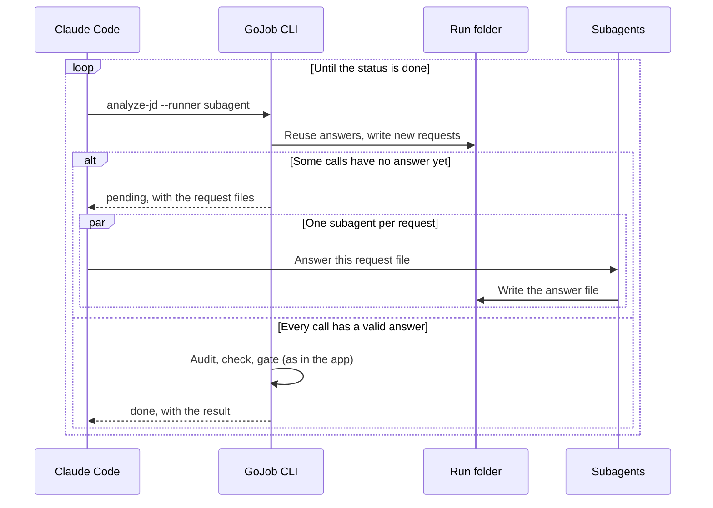
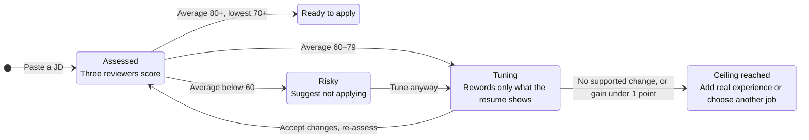

## End to end

Five steps on one page, all reading the same resume and story bank. JobLens v1 covered only step 3; the sections below show how it is built and how step 3 decides.

<b>1 · Profile</b>Resume health check

<b>2 · Find jobs</b>Region scan, real links only

<b>3 · Target JD</b>Apply decision, tailored resume, cover letter, networking<em>JobLens v1</em>

<b>4 · Tracker</b>One row per application

<b>5 · Interview coach</b>Practice from my story bank

Shared source of truth · resume · story bank · target JDs

## Trade-offs

| Choice | What it costs | Why I accept it |
|---|---|---|
| Read the resume from a Google Docs link, never write back | Changes come back as a Word file and Copy buttons | Writing back needs a Google sign-in a local tool should not hold |
| Lock the resume layout | Tuning can only reword the headline, summary, bullets and skills | Names, employers, titles and dates are facts, and the page count stays |
| Subagent mode (no API key) on the command line only | One job description per run, not the full web flow | It is a fallback for people without an API key |

## Architecture

Two ways in, one backend. Every answer passes the layout lock and the audit gate before it is saved, whether the Claude API or a Claude Code subagent wrote it.

<figure class="arch">
<svg xmlns="http://www.w3.org/2000/svg" viewBox="0 0 680 666" role="img" aria-labelledby="arch-t arch-d">
<title id="arch-t">GoJob system architecture</title>
<desc id="arch-d">From top to bottom: two entrances (the Next.js page and the command line with Claude Code), the Python backend, the skill files with the four AI roles built from them, the model client (Claude API or Claude Code subagents), a layout lock and audit gate, and local data files where the result is saved.</desc>
<defs><marker id="arch-arrow" viewBox="0 0 10 10" refX="8" refY="5" markerWidth="6" markerHeight="6" orient="auto"><path d="M2 1L8 5L2 9" fill="none" class="arr-head" stroke-width="1.5" stroke-linecap="round" stroke-linejoin="round"/></marker></defs>
<g class="gray"><rect x="40" y="20" width="290" height="56" rx="8"/>
<text class="th" x="185" y="40">Next.js single page</text>
<text class="ts" x="185" y="58">Five tabs · forwards /api/*</text></g>
<g class="gray"><rect x="350" y="20" width="290" height="56" rx="8"/>
<text class="th" x="495" y="40">Command line + Claude Code</text>
<text class="ts" x="495" y="58">run-gojob skill · no API key needed</text></g>
<line class="arr" x1="185" y1="76" x2="185" y2="102" marker-end="url(#arch-arrow)"/>
<line class="arr" x1="495" y1="76" x2="495" y2="102" marker-end="url(#arch-arrow)"/>
<g class="gray"><rect x="100" y="104" width="480" height="56" rx="8"/>
<text class="th" x="340" y="124">Python backend</text>
<text class="ts" x="340" y="142">Web: /api/* routes · CLI: gojob.cli · one set of task code</text></g>
<line class="arr" x1="340" y1="160" x2="340" y2="178" marker-end="url(#arch-arrow)"/>
<g class="skills"><rect x="28" y="180" width="624" height="156" rx="10"/>
<text class="th" x="340" y="198">Skills · 16 prompt files in backend/gojob/skills/</text>
<text class="ts" x="340" y="216">The task code reads the one file it names, on every call · nothing scans the folder</text>
<text class="ts" x="340" y="232">Also here: shared rules (used by every role) and the auditor prompt (used by the audit gate)</text></g>
<g class="purple"><rect x="40" y="248" width="135" height="72" rx="8"/>
<text class="th" x="107" y="268">Writer</text><text class="ts" x="107" y="288">Analysis, tuning</text><text class="ts" x="107" y="305">Letter, questions</text></g>
<g class="purple"><rect x="195" y="248" width="135" height="72" rx="8"/>
<text class="th" x="262" y="268">Review panel</text><text class="ts" x="262" y="288">Three reviewers</text><text class="ts" x="262" y="305">score in parallel</text></g>
<g class="purple"><rect x="350" y="248" width="135" height="72" rx="8"/>
<text class="th" x="417" y="268">Search agent</text><text class="ts" x="417" y="288">Jobs · people</text><text class="ts" x="417" y="305">Company research</text></g>
<g class="purple"><rect x="505" y="248" width="135" height="72" rx="8"/>
<text class="th" x="572" y="268">Interview coach</text><text class="ts" x="572" y="288">Questions</text><text class="ts" x="572" y="305">Feedback · report</text></g>
<line class="arr" x1="107" y1="320" x2="107" y2="364" marker-end="url(#arch-arrow)"/>
<line class="arr" x1="262" y1="320" x2="262" y2="364" marker-end="url(#arch-arrow)"/>
<line class="arr" x1="417" y1="320" x2="417" y2="364" marker-end="url(#arch-arrow)"/>
<line class="arr" x1="572" y1="320" x2="572" y2="364" marker-end="url(#arch-arrow)"/>
<g class="amber"><rect x="40" y="366" width="600" height="56" rx="8"/>
<text class="th" x="340" y="386">Model client · the only code that calls a model</text>
<text class="ts" x="340" y="404">Claude API (default) · or Claude Code subagents through files (CLI only)</text></g>
<line class="arr" x1="107" y1="422" x2="107" y2="454" marker-end="url(#arch-arrow)"/>
<line class="arr" x1="262" y1="422" x2="262" y2="454" marker-end="url(#arch-arrow)"/>
<line class="arr" x1="417" y1="422" x2="417" y2="454" marker-end="url(#arch-arrow)"/>
<line class="arr" x1="572" y1="422" x2="572" y2="454" marker-end="url(#arch-arrow)"/>
<g class="teal"><rect x="40" y="456" width="600" height="84" rx="8"/>
<line class="div" x1="245" y1="466" x2="245" y2="530"/>
<text class="th" x="142" y="474">1 · Layout lock</text>
<text class="ts" x="142" y="494">Resume changes only:</text>
<text class="ts" x="142" y="511">name, sections, employers,</text>
<text class="ts" x="142" y="528">titles, dates stay locked</text>
<text class="th" x="442" y="474">2 · Audit gate (with_audit)</text>
<text class="ts" x="442" y="494">Five Haiku auditors + word-for-word quote check</text>
<text class="ts" x="442" y="511">Fails: the same role rewrites once</text>
<text class="ts" x="442" y="528">(search roles are audited only)</text></g>
<line class="arr" x1="135" y1="540" x2="135" y2="572" marker-end="url(#arch-arrow)"/>
<line class="arr" x1="340" y1="540" x2="340" y2="572" marker-end="url(#arch-arrow)"/>
<line class="arr" x1="545" y1="540" x2="545" y2="572" marker-end="url(#arch-arrow)"/>
<g class="gray"><rect x="40" y="574" width="190" height="56" rx="8"/>
<text class="th" x="135" y="594">data/db.json</text><text class="ts" x="135" y="612">State and results</text></g>
<g class="gray"><rect x="245" y="574" width="190" height="56" rx="8"/>
<text class="th" x="340" y="594">data/files/</text><text class="ts" x="340" y="612">Resume .docx files</text></g>
<g class="gray"><rect x="450" y="574" width="190" height="56" rx="8"/>
<text class="th" x="545" y="594">data/manual/</text><text class="ts" x="545" y="612">Subagent runs · private</text></g>
</svg>
</figure>

## Prompts as skills

Rules used by several skills, such as the ground rules and work-visa signals, live in one shared file. To change a prompt: edit one skill, run the tests and evals, and compare with the last run, which names the skills that changed.

| Step | Skills |
|---|---|
| Shared | `shared-rules`: ground rules, change rules, visa signals, search honesty, language |
| 1 · Profile | `health-check`, `panel-scorer` |
| 2 · Find jobs | `scout`, `company-watch`, `networking` |
| 3 · Target JD | `jd-match`, `panel-scorer`, `fine-tune`, `cover-letter`, `interview-prep`, `networking`, `one-pager` |
| 5 · Interview coach | `interview-coach`, `coach-question`, `coach-feedback`, `coach-report` |
| Every answer | `auditor`: one focus per auditor, five in all |

## Answering without an API key

From the command line, Claude Code subagents can answer instead of the API. The command writes a request file for each model call and reruns until every call has an answer, then applies the same audit and gate as the app.

## Step 3 · Apply, tune or stop

A job is scored, then ready to apply, risky, or sent to tuning. Tuning can only reword what is already true, so it has a ceiling.

## Building it with AI

GoJob was built with Claude Code. I owned the product decisions: what each step should produce, the honesty rules, the apply and tuning gates, and the trap cases that test them. Claude wrote most of the code and tests against those rules, and every change went through the test suite and my review before it was committed.
