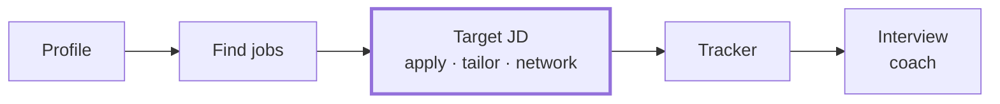
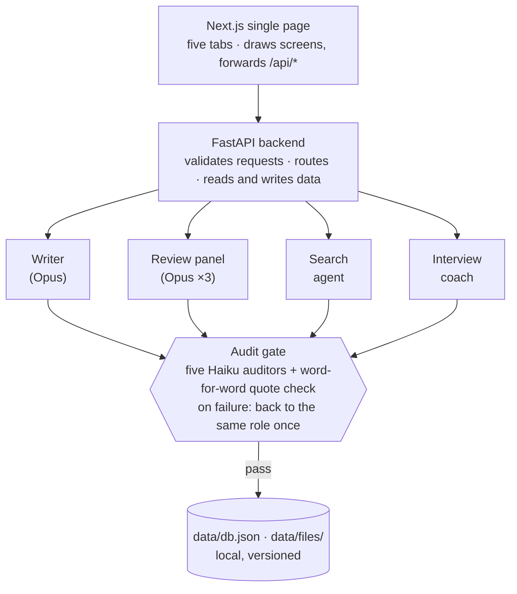
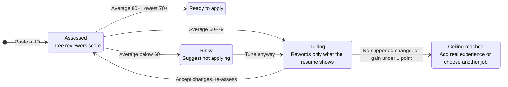
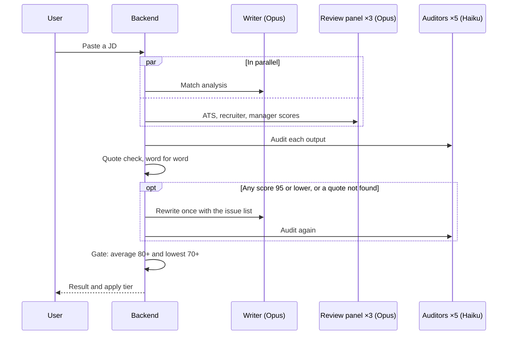

## From JobLens to GoJob

| | v1 · JobLens | v2 · GoJob |
|---|---|---|
| **Covers** | Fit check and tracking | Resume health, job scan, fit, tailored resume and cover letter, interview prep, networking, tracking |
| **Model** | Gemini, one analysis call | Claude: a writer, a three-reviewer panel, five auditors |
| **Trust** | Prompt rules against hallucination | Word-for-word quote checks in code, audit gate, repair pass |
| **Measured by** | Time saved per job | Synthetic trap cases and run-to-run regression checks |
| **Where it lived** | One tool, plus several Claude Projects on the side | One workspace |

## End to end

v1 covered one step. v2 connects the whole search, and every step reads from the same profile and story bank.

*Bold outline: Target JD, the only step JobLens v1 covered.*

## Architecture and the audit gate

The screens only draw. The Python backend runs four AI roles, and every answer passes the audit gate before it is saved.

## How a job moves

A job is scored, then either ready to apply, risky, or sent to tuning. Tuning can only reword what is already true, so it has a ceiling.

## What happens when you paste a JD

