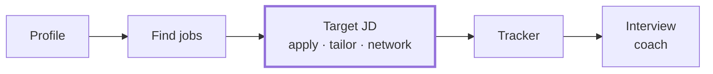
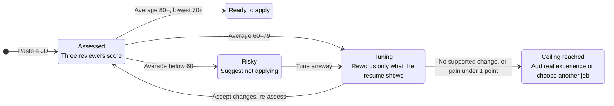
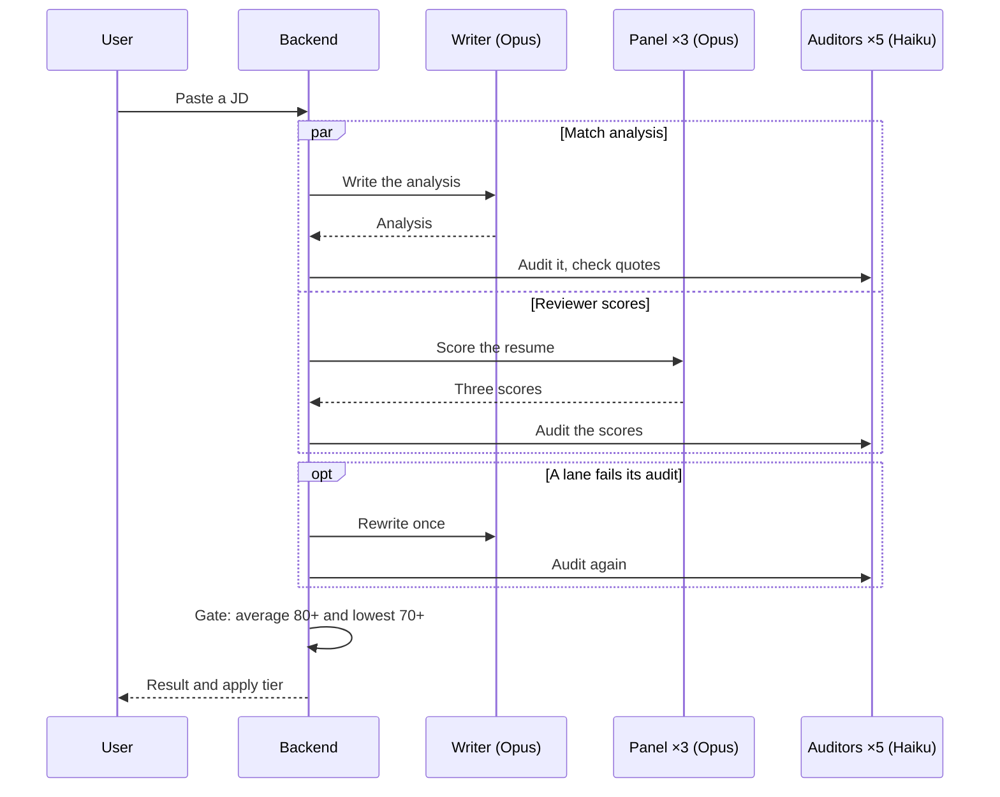
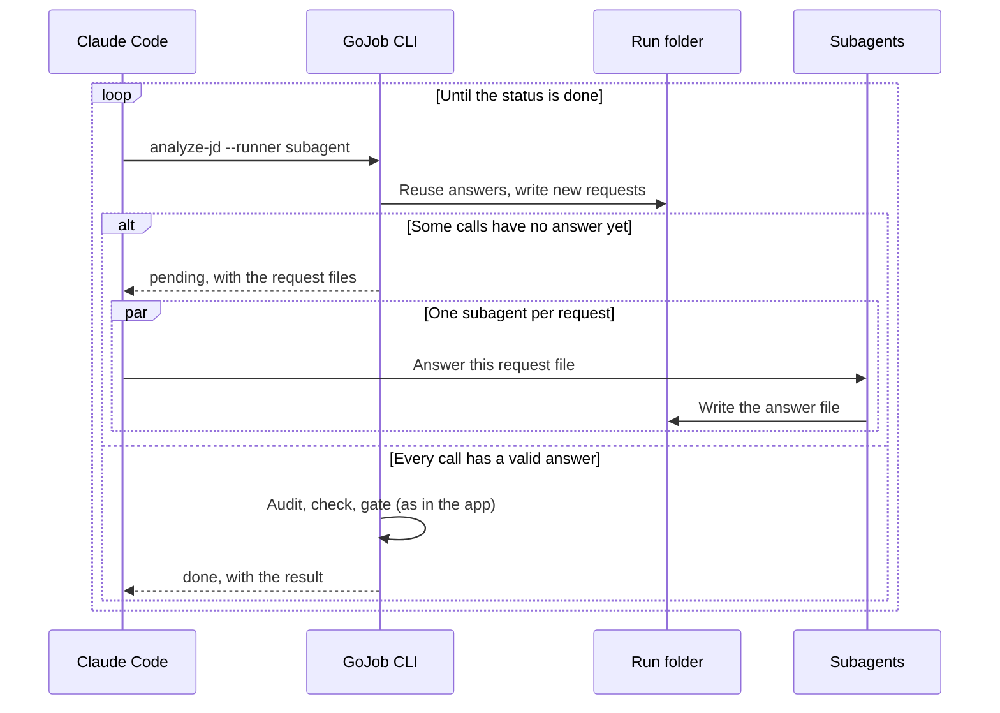

## From JobLens to GoJob

| | v1 · JobLens | v2 · GoJob |
|---|---|---|
| **Covers** | Fit check and tracking | Resume health, job scan, fit, tailored resume and cover letter, interview prep, networking, tracking |
| **Model** | Gemini, one analysis call | Claude: a writer, a three-reviewer panel, five auditors |
| **Trust** | Prompt rules against hallucination | Word-for-word quote checks in code, audit gate, repair pass |
| **Measured by** | Time saved per job | Synthetic trap cases and run-to-run regression checks |
| **Where it lived** | One tool, plus several Claude Projects on the side | One workspace |

## End to end

v1 covered one step. v2 connects the whole search, and every step reads from the same profile and story bank.

*Bold outline: Target JD, the only step JobLens v1 covered.*

## Architecture and the audit gate

There are two ways in: the web page, which only draws, and the command line through Claude Code. One Python backend builds four AI roles from skill files, reading the one file each task names, and a single model client decides who answers: the Claude API, or Claude Code subagents when there is no API key. Every answer passes the layout lock and the audit gate before it is saved.

<figure class="arch">
<svg xmlns="http://www.w3.org/2000/svg" viewBox="0 0 680 666" role="img" aria-labelledby="arch-t arch-d">
<title id="arch-t">GoJob system architecture</title>
<desc id="arch-d">From top to bottom: two entrances (the Next.js page and the command line with Claude Code), the Python backend, the skill files with the four AI roles built from them, the model client (Claude API or Claude Code subagents), a layout lock and audit gate, and local data files where the result is saved.</desc>
<defs><marker id="arch-arrow" viewBox="0 0 10 10" refX="8" refY="5" markerWidth="6" markerHeight="6" orient="auto"><path d="M2 1L8 5L2 9" fill="none" class="arr-head" stroke-width="1.5" stroke-linecap="round" stroke-linejoin="round"/></marker></defs>
<g class="gray"><rect x="40" y="20" width="290" height="56" rx="8"/>
<text class="th" x="185" y="40">Next.js single page</text>
<text class="ts" x="185" y="58">Five tabs · forwards /api/*</text></g>
<g class="gray"><rect x="350" y="20" width="290" height="56" rx="8"/>
<text class="th" x="495" y="40">Command line + Claude Code</text>
<text class="ts" x="495" y="58">run-gojob skill · no API key needed</text></g>
<line class="arr" x1="185" y1="76" x2="185" y2="102" marker-end="url(#arch-arrow)"/>
<line class="arr" x1="495" y1="76" x2="495" y2="102" marker-end="url(#arch-arrow)"/>
<g class="gray"><rect x="100" y="104" width="480" height="56" rx="8"/>
<text class="th" x="340" y="124">Python backend</text>
<text class="ts" x="340" y="142">Web: /api/* routes · CLI: gojob.cli · one set of task code</text></g>
<line class="arr" x1="340" y1="160" x2="340" y2="178" marker-end="url(#arch-arrow)"/>
<g class="skills"><rect x="28" y="180" width="624" height="156" rx="10"/>
<text class="th" x="340" y="198">Skills · 16 prompt files in backend/gojob/skills/</text>
<text class="ts" x="340" y="216">The task code reads the one file it names, on every call · nothing scans the folder</text>
<text class="ts" x="340" y="232">Also here: shared rules (used by every role) and the auditor prompt (used by the audit gate)</text></g>
<g class="purple"><rect x="40" y="248" width="135" height="72" rx="8"/>
<text class="th" x="107" y="268">Writer</text><text class="ts" x="107" y="288">Analysis, tuning</text><text class="ts" x="107" y="305">Letter, questions</text></g>
<g class="purple"><rect x="195" y="248" width="135" height="72" rx="8"/>
<text class="th" x="262" y="268">Review panel</text><text class="ts" x="262" y="288">Three reviewers</text><text class="ts" x="262" y="305">score in parallel</text></g>
<g class="purple"><rect x="350" y="248" width="135" height="72" rx="8"/>
<text class="th" x="417" y="268">Search agent</text><text class="ts" x="417" y="288">Jobs · people</text><text class="ts" x="417" y="305">Company research</text></g>
<g class="purple"><rect x="505" y="248" width="135" height="72" rx="8"/>
<text class="th" x="572" y="268">Interview coach</text><text class="ts" x="572" y="288">Questions</text><text class="ts" x="572" y="305">Feedback · report</text></g>
<line class="arr" x1="107" y1="320" x2="107" y2="364" marker-end="url(#arch-arrow)"/>
<line class="arr" x1="262" y1="320" x2="262" y2="364" marker-end="url(#arch-arrow)"/>
<line class="arr" x1="417" y1="320" x2="417" y2="364" marker-end="url(#arch-arrow)"/>
<line class="arr" x1="572" y1="320" x2="572" y2="364" marker-end="url(#arch-arrow)"/>
<g class="amber"><rect x="40" y="366" width="600" height="56" rx="8"/>
<text class="th" x="340" y="386">Model client · the only code that calls a model</text>
<text class="ts" x="340" y="404">Claude API (default) · or Claude Code subagents through files (CLI only)</text></g>
<line class="arr" x1="107" y1="422" x2="107" y2="454" marker-end="url(#arch-arrow)"/>
<line class="arr" x1="262" y1="422" x2="262" y2="454" marker-end="url(#arch-arrow)"/>
<line class="arr" x1="417" y1="422" x2="417" y2="454" marker-end="url(#arch-arrow)"/>
<line class="arr" x1="572" y1="422" x2="572" y2="454" marker-end="url(#arch-arrow)"/>
<g class="teal"><rect x="40" y="456" width="600" height="84" rx="8"/>
<line class="div" x1="245" y1="466" x2="245" y2="530"/>
<text class="th" x="142" y="474">1 · Layout lock</text>
<text class="ts" x="142" y="494">Resume changes only:</text>
<text class="ts" x="142" y="511">name, sections, employers,</text>
<text class="ts" x="142" y="528">titles, dates stay locked</text>
<text class="th" x="442" y="474">2 · Audit gate (with_audit)</text>
<text class="ts" x="442" y="494">Five Haiku auditors + word-for-word quote check</text>
<text class="ts" x="442" y="511">Fails: the same role rewrites once</text>
<text class="ts" x="442" y="528">(search roles are audited only)</text></g>
<line class="arr" x1="135" y1="540" x2="135" y2="572" marker-end="url(#arch-arrow)"/>
<line class="arr" x1="340" y1="540" x2="340" y2="572" marker-end="url(#arch-arrow)"/>
<line class="arr" x1="545" y1="540" x2="545" y2="572" marker-end="url(#arch-arrow)"/>
<g class="gray"><rect x="40" y="574" width="190" height="56" rx="8"/>
<text class="th" x="135" y="594">data/db.json</text><text class="ts" x="135" y="612">State and results</text></g>
<g class="gray"><rect x="245" y="574" width="190" height="56" rx="8"/>
<text class="th" x="340" y="594">data/files/</text><text class="ts" x="340" y="612">Resume .docx files</text></g>
<g class="gray"><rect x="450" y="574" width="190" height="56" rx="8"/>
<text class="th" x="545" y="594">data/manual/</text><text class="ts" x="545" y="612">Subagent runs · private</text></g>
</svg>
</figure>

## Prompts as skills

Every prompt is a plain-text skill file, split by function. Rules used by several skills, such as the ground rules, resume change rules and work-visa signals, live in one shared file and are included by reference.

| Step | Skills |
|---|---|
| Shared | `shared-rules`: ground rules, change rules, visa signals, search honesty, language |
| 1 · Profile | `health-check`, `panel-scorer` |
| 2 · Find jobs | `scout`, `company-watch`, `networking` |
| 3 · Target JD | `jd-match`, `panel-scorer`, `fine-tune`, `cover-letter`, `interview-prep`, `networking`, `one-pager` |
| 5 · Interview coach | `interview-coach`, `coach-question`, `coach-feedback`, `coach-report` |
| Every answer | `auditor`: one focus per auditor, five in all |

Iterating on a prompt follows one loop: edit a skill, run the tests (every include and variable must resolve), run the evals and compare with the last run. The comparison names the skills that changed, and every saved answer carries a fingerprint of the skills that produced it.

## How a job moves

A job is scored, then either ready to apply, risky, or sent to tuning. Tuning can only reword what is already true, so it has a ceiling.

## What happens when you paste a JD

The match analysis and the reviewer scores run as two parallel lanes. Each lane is audited on its own, and only a lane that fails is rewritten.

## Answering without an API key

From the command line, the same flow can be answered by Claude Code subagents instead of the API. The code still decides what to ask and whether the answer passes; only who answers changes.

