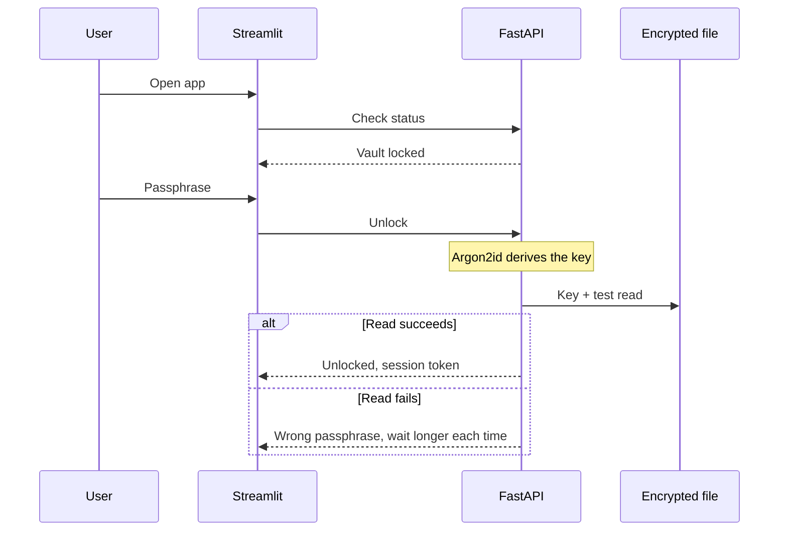
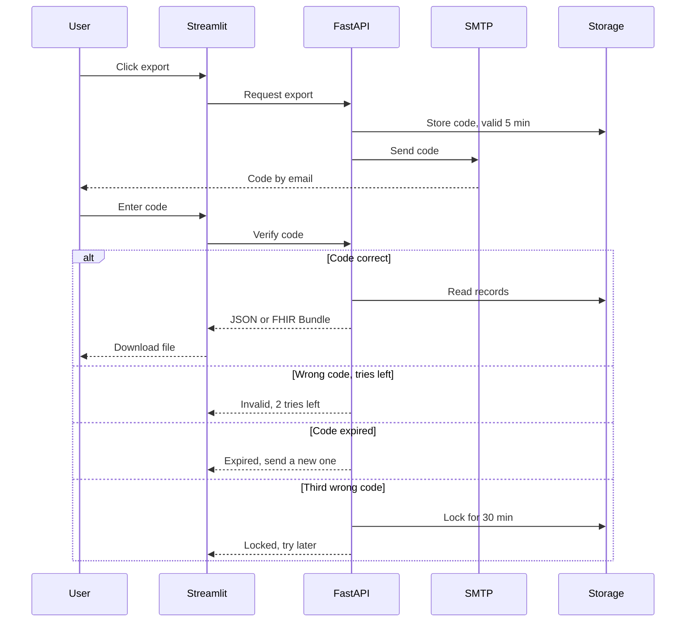

## End to end

One session, from first run to taking the data out. Phase 1 covers the highlighted steps; the sections below walk through the three that Phase 2 adds.

<b>1 · Set up</b>Wizard picks login, tokens and storage

<b>2 · Sign in</b>Email code, or unlock the vault with a passphrase

<b>3 · Record</b>Blood pressure, heart rate, glucose, SpO2<em>Phase 1</em>

<b>4 · Review</b>History, goals, trend charts<em>Phase 1</em>

<b>5 · Export</b>JSON or FHIR, after an email code

Three independent options · login · token store · data storage

## Trade-offs

| Choice | What it costs | Why I accept it |
|---|---|---|
| Key derived from the passphrase | Forget it without the recovery key and the data is gone | Any recovery path that bypasses the passphrase could also be used by someone else |
| Email required in every setup | “Local-only” still needs SMTP for sensitive actions | A second factor exactly where data can leave or be overwritten |
| Shorter tokens and idle lock in local modes | Signing in more often | A dashboard can sit open on a shared screen at home |
| Third-party features opt-in, per feature | Fewer integrations out of the box | The local-only promise stays true unless the user turns a feature on |

## Architecture

One backend, three switches. Green parts exist today; purple parts are the Phase 2 design.

<figure class="arch">
<svg xmlns="http://www.w3.org/2000/svg" viewBox="0 0 680 700" role="img" aria-labelledby="cp-arch-t cp-arch-d">
<title id="cp-arch-t">HealthTally system architecture</title>
<desc id="cp-arch-d">The Streamlit dashboard calls a FastAPI backend with four parts: auth gate, health APIs, config API and data import and export. Below it are three independent options set by config: login (email code, passphrase, or both), token store (Upstash Redis or a local store) and data storage (PostgreSQL or encrypted SQLite). A verified email is required in every setup. Export, import and storage changes need an email code step-up, and the only data that leaves is a JSON or FHIR file.</desc>
<defs><marker id="cp-arrow" viewBox="0 0 10 10" refX="8" refY="5" markerWidth="6" markerHeight="6" orient="auto"><path d="M2 1L8 5L2 9" fill="none" class="arr-head" stroke-width="1.5" stroke-linecap="round" stroke-linejoin="round"/></marker></defs>
<g class="gray"><rect x="200" y="20" width="280" height="56" rx="8"/>
<text class="th" x="340" y="40">Streamlit dashboard</text>
<text class="ts" x="340" y="58">Pages · setup wizard · settings</text></g>
<line class="arr" x1="340" y1="76" x2="340" y2="102" marker-end="url(#cp-arrow)"/>
<g class="gray dashed"><rect x="40" y="104" width="600" height="116" rx="12"/>
<text class="th" x="340" y="124">FastAPI backend</text></g>
<g class="purple"><rect x="49" y="142" width="132" height="60" rx="8"/>
<text class="th" x="115" y="162">Auth gate</text><text class="ts" x="115" y="182">Any login method</text></g>
<g class="teal"><rect x="199" y="142" width="132" height="60" rx="8"/>
<text class="th" x="265" y="162">Health APIs</text><text class="ts" x="265" y="182">Record, goal, chart</text></g>
<g class="purple"><rect x="349" y="142" width="132" height="60" rx="8"/>
<text class="th" x="415" y="162">Config API</text><text class="ts" x="415" y="182">Wizard, settings</text></g>
<g class="purple"><rect x="499" y="142" width="132" height="60" rx="8"/>
<text class="th" x="565" y="162">Data I/O</text><text class="ts" x="565" y="182">Export, import</text></g>
<line class="arr" x1="340" y1="220" x2="340" y2="250" marker-end="url(#cp-arrow)"/>
<g class="gray dashed"><rect x="40" y="252" width="600" height="302" rx="12"/>
<text class="th" x="340" y="272">Options, set by config · each row is independent</text></g>
<text class="th" x="56" y="312" style="text-anchor:start;fill:#2C2C2A">Login</text>
<text class="ts" x="56" y="330" style="text-anchor:start;fill:#5F5E5A">Both can be on</text>
<g class="teal"><rect x="190" y="295" width="205" height="52" rx="8"/>
<text class="th" x="292" y="312">Email code login</text><text class="ts" x="292" y="330">SMTP sends the code</text></g>
<text class="th" x="405" y="321" style="fill:#2C2C2A">+</text>
<g class="purple"><rect x="415" y="295" width="205" height="52" rx="8"/>
<text class="th" x="517" y="312">Passphrase or PIN</text><text class="ts" x="517" y="330">Argon2id · idle lock</text></g>
<text class="th" x="56" y="376" style="text-anchor:start;fill:#2C2C2A">Token store</text>
<text class="ts" x="56" y="394" style="text-anchor:start;fill:#5F5E5A">Pick one</text>
<g class="teal"><rect x="190" y="359" width="205" height="52" rx="8"/>
<text class="th" x="292" y="376">Upstash Redis</text><text class="ts" x="292" y="394">Codes, token ids</text></g>
<g class="purple"><rect x="415" y="359" width="205" height="52" rx="8"/>
<text class="th" x="517" y="376">Local store</text><text class="ts" x="517" y="394">On this machine, no Redis</text></g>
<text class="th" x="56" y="440" style="text-anchor:start;fill:#2C2C2A">Data storage</text>
<text class="ts" x="56" y="458" style="text-anchor:start;fill:#5F5E5A">Pick one</text>
<g class="teal"><rect x="190" y="423" width="205" height="52" rx="8"/>
<text class="th" x="292" y="440">PostgreSQL</text><text class="ts" x="292" y="458">User and health data</text></g>
<g class="purple"><rect x="415" y="423" width="205" height="52" rx="8"/>
<text class="th" x="517" y="440">SQLite + SQLCipher</text><text class="ts" x="517" y="458">Local file, encrypted</text></g>
<text class="th" x="56" y="504" style="text-anchor:start;fill:#2C2C2A">Email</text>
<text class="ts" x="56" y="522" style="text-anchor:start;fill:#5F5E5A">Every setup</text>
<g class="purple"><rect x="190" y="487" width="430" height="52" rx="8"/>
<text class="th" x="405" y="504">Verified email + SMTP</text><text class="ts" x="405" y="522">Sends codes only, never health data</text></g>
<path class="arr" d="M631 172 L662 172 L662 618 L642 618" marker-end="url(#cp-arrow)"/>
<line class="arr" x1="495" y1="590" x2="495" y2="543" marker-end="url(#cp-arrow)"/>
<g class="purple"><rect x="350" y="590" width="290" height="56" rx="8"/>
<text class="th" x="495" y="610">Email code step-up</text><text class="ts" x="495" y="628">Export, import, storage switch</text></g>
<line class="arr" x1="350" y1="618" x2="322" y2="618" marker-end="url(#cp-arrow)"/>
<g class="gray"><rect x="40" y="590" width="280" height="56" rx="8"/>
<text class="th" x="180" y="610">Data file</text><text class="ts" x="180" y="628">JSON or FHIR · the only way out</text></g>
<g class="teal"><rect x="40" y="672" width="12" height="12" rx="2"/></g>
<text class="ts" x="60" y="678" style="text-anchor:start;fill:var(--muted)">Phase 1 · built</text>
<g class="purple"><rect x="180" y="672" width="12" height="12" rx="2"/></g>
<text class="ts" x="200" y="678" style="text-anchor:start;fill:var(--muted)">Phase 2 · designed</text>
</svg>
</figure>

## Step 1 · Set up

The first-run wizard offers four presets, and the settings page can change any option later. Encrypted storage forces passphrase login, because an email code cannot derive the key. The wizard only answers on the machine itself, needs a one-time code the server prints, and closes when setup is done.

| Preset | Login | Token store | Data storage |
|---|---|---|---|
| Local vault | Passphrase | Local store | SQLite + SQLCipher |
| Cloud connected (the Phase 1 setup) | Email code | Upstash Redis | PostgreSQL |
| Hybrid | Passphrase + email code | Local store | SQLite, encryption optional |
| Advanced | Pick each | Pick each | Pick each |

## Step 2 · Sign in

With encrypted storage the service starts locked until the passphrase opens the file. Each wrong attempt waits longer.

## Step 5 · Export, and who checks what

The check matches the risk: an email code for anything that moves data, the passphrase for credentials, an active session for low-risk switches. In an email-only setup, the passphrase tier falls back to an email code.

| Verification | Actions |
|---|---|
| Email code | Export, import, switch data storage, change email |
| Current passphrase | Change passphrase, change login methods |
| Active session | Switch token store |

Export runs like this (5 minutes, 3 tries and a 30-minute lock are proposed defaults):

## Building it with AI

Phase 1 was written entirely by hand, without AI assistance. From Phase 2, Claude Code is part of the development flow. I own the decisions: the three switches, which actions need which check, and what may ever leave the machine. Claude writes code against those rules, and I review every change before it is committed.
